# Tuner

[](https://github.com/rthoms334/omatuner/actions/workflows/ci.yml)
[](https://github.com/rthoms334/omatuner/releases)

Tuner is a keyboard-first IPTV player for [Omarchy](https://omarchy.org) (Hyprland). It plays
live TV, catch-up, movies and series from M3U playlists and Xtream Codes accounts, and has an
XMLTV programme guide. It looks like the rest of your Omarchy desktop: colours follow the
current theme live, corners are square, and the font is JetBrains Mono Nerd Font.

The video is rendered by an embedded libmpv inside a native Rust window (egui), so there is no
browser or Electron runtime and no separate player window.


- [Screenshots](#screenshots)
- [Features](#features)
- [Requirements](#requirements)
- [Build and install](#build-and-install)
- [First run](#first-run)
- [Adding sources](#adding-sources)
- [TV guide and guide coverage](#tv-guide-and-guide-coverage)
- [Keyboard](#keyboard)
- [Command line](#command-line)
- [Use Tuner from Claude](#use-tuner-from-claude)
- [Files and profiles](#files-and-profiles)
- [Theming](#theming)
- [Omarchy integration](#omarchy-integration)
- [Troubleshooting](#troubleshooting)
- [Privacy](#privacy)
- [Development](#development)
- [Licence](#licence)

## Screenshots

<table>
<tr>
<td width="50%">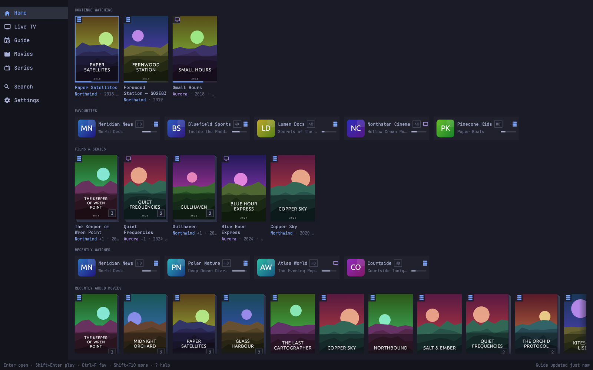<br><b>Home</b>: Continue watching, favourites lists and recently added titles.</td>
<td width="50%">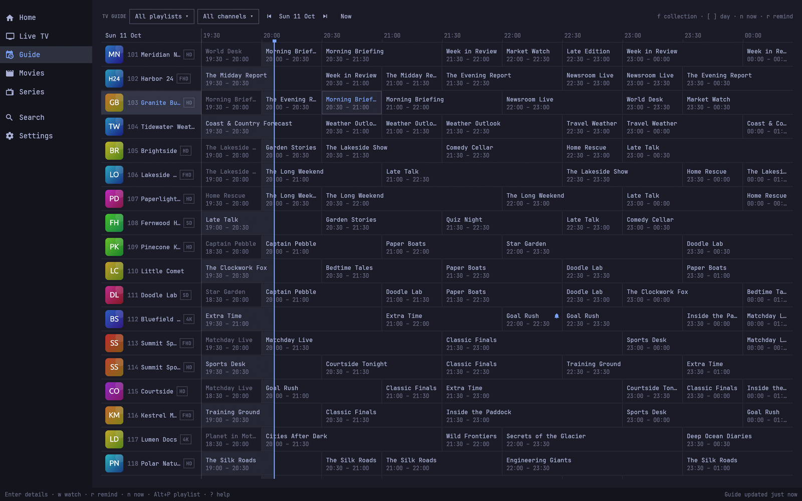<br><b>Guide</b>: a day of programmes; the bell marks a reminder.</td>
</tr>
<tr>
<td width="50%">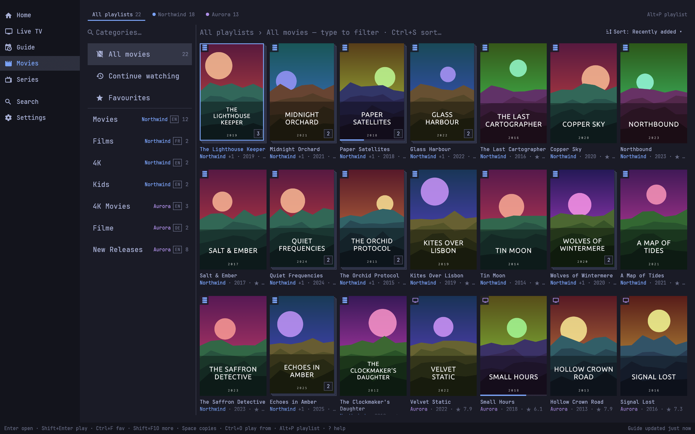<br><b>Movies</b> in <i>All playlists</i>: the scope bar on top, and the same title from several playlists stacked into one card.</td>
<td width="50%">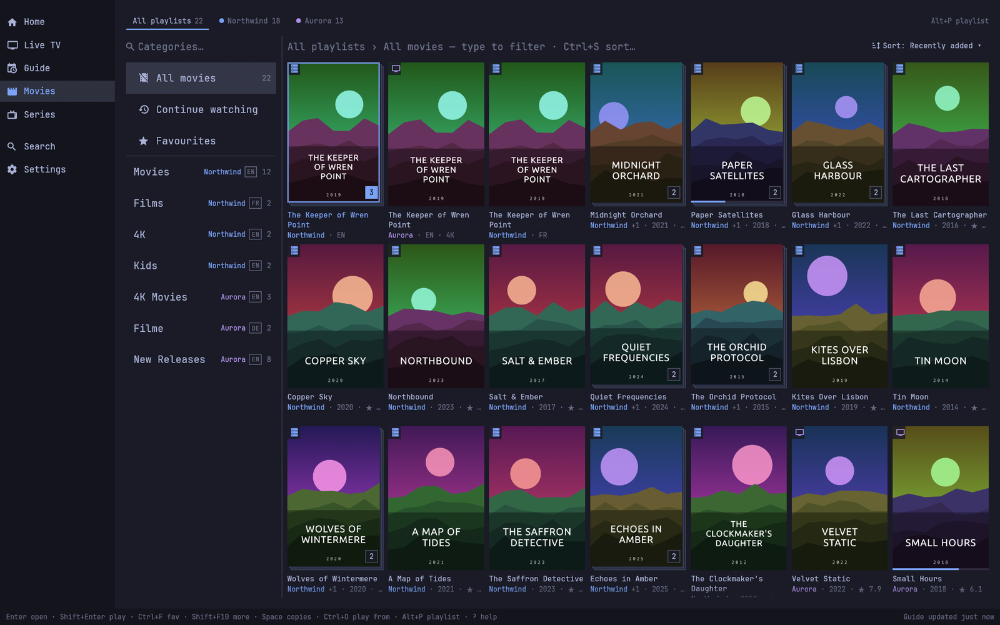<br><code>Space</code> fans a stack out into its copies, each with its playlist, language and quality.</td>
</tr>
<tr>
<td width="50%">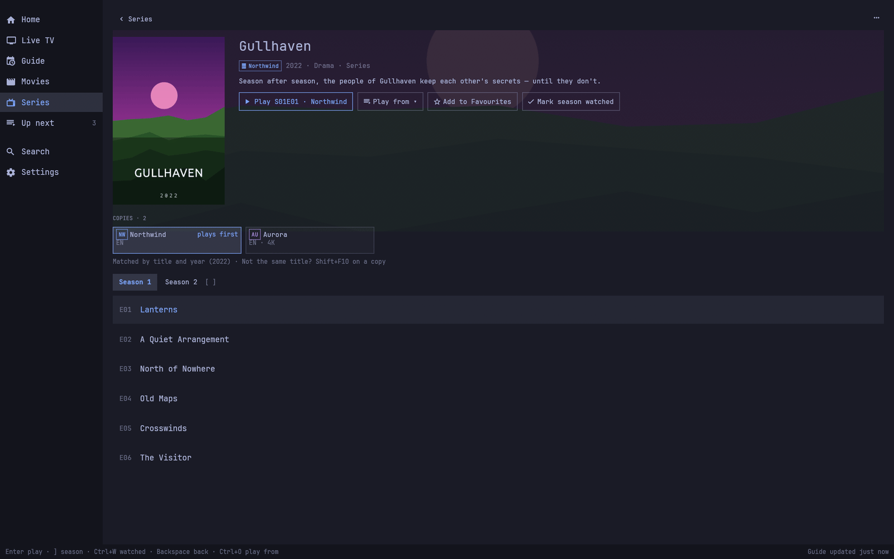<br><b>Series page</b> with its copies: which one plays first, and the others to pick from.</td>
<td width="50%">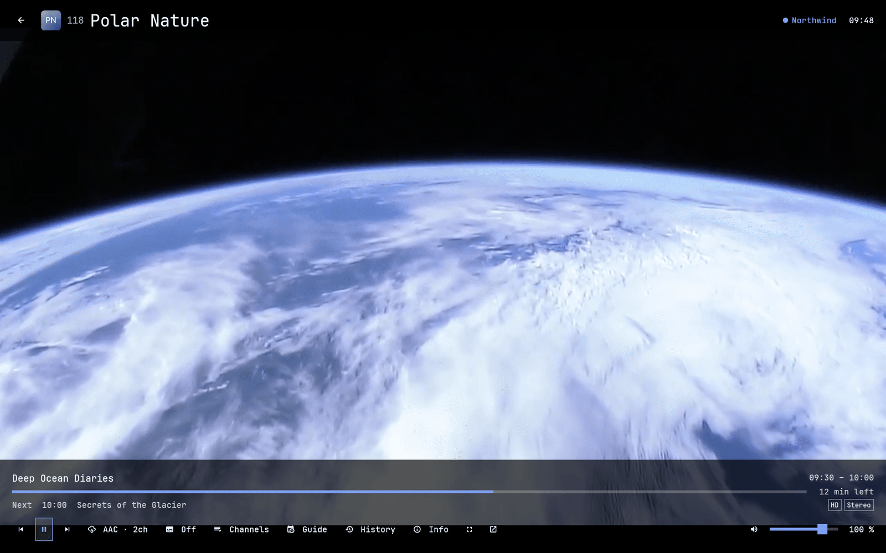<br><b>Player</b> with the on-screen controls and the volume slider.</td>
</tr>
<tr>
<td width="50%">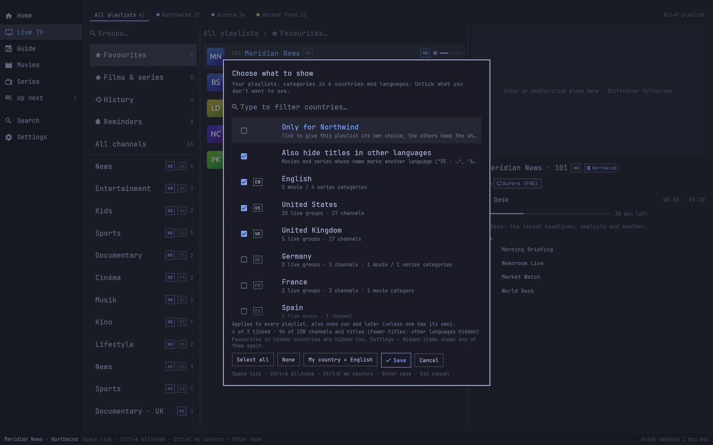<br><b>Choose what to show</b>: keep only the countries and languages you want from your playlists.</td>
<td width="50%">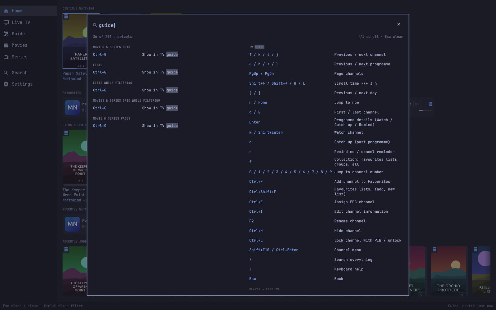<br><b>Keyboard help</b> (<code>F1</code> or <code>?</code>), filtered by typing.</td>
</tr>
<tr>
<td width="50%">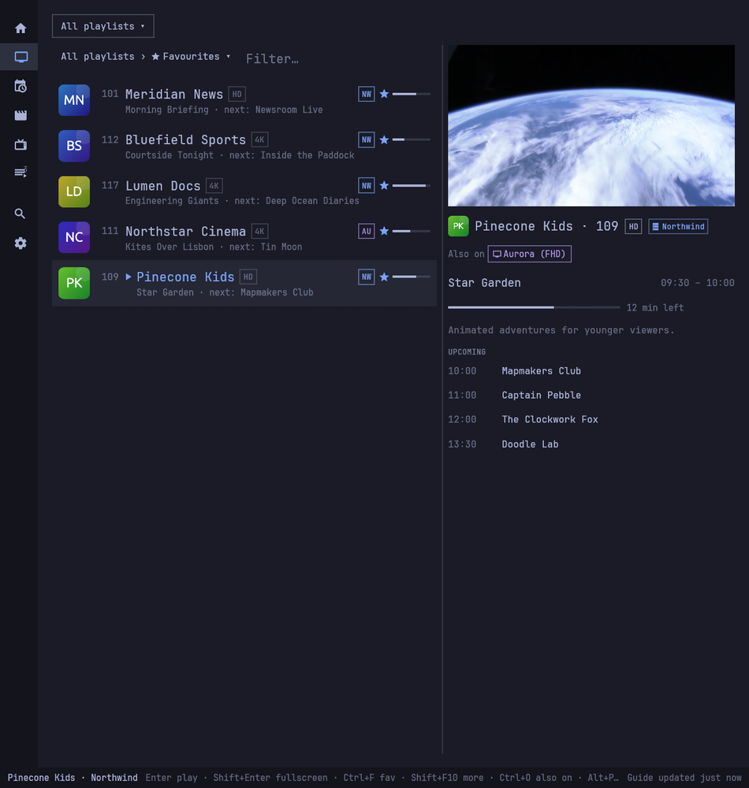<br>Live TV in <b>half a screen</b>: the sidebar folds into icons.</td>
<td width="50%">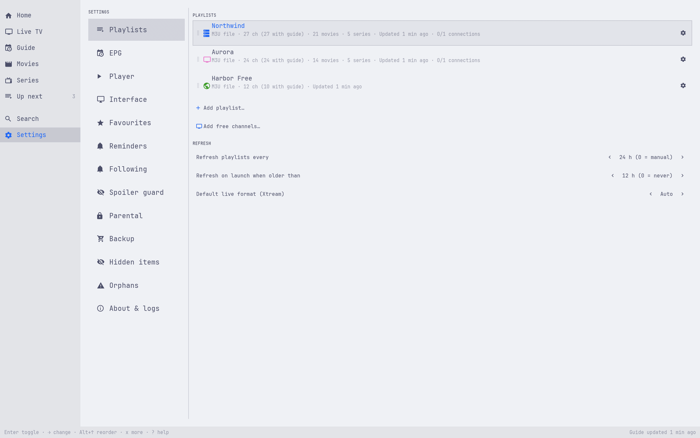<br><b>Settings ▸ Playlists</b> in a light theme (Catppuccin Latte).</td>
</tr>
<tr>
<td width="50%">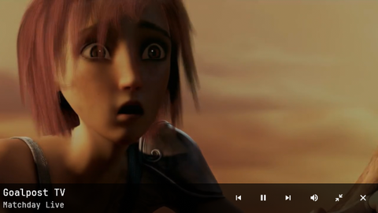<br><b>Pop-out</b> (<code>o</code>): a small player pinned on every workspace (Hyprland).</td>
<td width="50%"></td>
</tr>
</table>

Everything in these screenshots is made up: the playlists, channels, programmes, logos and
posters come from a demo profile (`examples/demo_profile.rs`), and `scripts/screenshots.sh`
takes the pictures. The theme is Omarchy's Tokyo Night unless noted. The video is from the
*Sintel* trailer, © copyright Blender Foundation |
[durian.blender.org](https://durian.blender.org/sharing/), licensed under
[CC BY 3.0](https://creativecommons.org/licenses/by/3.0/).

## Features

- **Sources:** M3U by URL or local file, and Xtream Codes (live, movies, series and the
  provider's guide). You can add several playlists, each with its own colour and glyph badge.
  A new playlist gets a colour no other playlist uses, and Settings ▸ Playlists offers to fix
  two playlists that share a colour.
- **Several playlists:** when two or more playlists have movies, series or channels, Movies,
  Series and Live TV get a bar on top: *All playlists* or one playlist, each with its count.
  Pick one with a click, `Alt+P` (a picker; digits jump) or `Ctrl+PgDn` / `Ctrl+PgUp`. Each
  screen remembers its own choice and the guide follows Live TV. One playlist shows only its
  categories, groups and channels (zapping too), with a stripe in its colour, a breadcrumb
  (`TV 2 › Action`) and the window title `Tuner — Movies · TV 2`. In *All playlists*, cards,
  channel rows, group rows and search results say which playlist each item comes from with a
  short code chip in its colour (`NW` for Northwind, `TV2` for TV 2 — derived from the name and
  unique, or your own in the playlist's editor); hover or focus an item to read the full name
  in the tooltip and the status bar. Detail pages and the player always name the playlist. A playlist's *Show in All playlists* switch keeps, say, free channels
  out of the All view (your favourites and history still list them). Settings ▸ Interface ▸ Playlist on cards switches the marks to Always or
  Never.
  A provider's M3U (a `get.php?username=…` link or a downloaded file) switches to its Xtream
  login automatically, so movies, series and catch-up appear; providers that don't allow that
  still get their movies and series sorted out of the playlist. *Try free channels* adds a
  free iptv-org or Free-TV playlist in two keystrokes. Tuner refreshes playlists in the
  background and shows account information (expiry, connections, formats).
- **Live TV:** groups, channel rows with now/next and progress, and a preview pane.
  - Zap with ↑/↓, recall the last channel, and browse your history.
  - Keep several favourites lists.
  - Hide, rename and reorder channels and groups; mark several groups and hide them at once.
  - Keep only the countries and languages you want from a provider's categories
    ("UK | Sports", "[FR] Films", "AR: News"…), including categories the provider adds later —
    one choice for all your playlists, and optionally titles in other languages hidden too.
  - Type a channel number to jump to it.
  - Quality badges (SD, HD, FHD, 4K) next to channel names, so the SD/HD/4K copies of a channel
    are told apart without playing each one; the best copy is listed first. A badge comes from
    the provider's name until the channel plays, then from the resolution it really plays at
    (a "4K" channel that plays at 1080p shows FHD). When the channels a playlist labels 4K keep
    playing at a lower quality (half of those you played, once you played at least three
    channels of it and two of them claimed 4K), its other "4K" channels show **4K?** (after
    the next restart or refresh) until they play: the provider says 4K, but it isn't
    verified. The same goes for FHD. Hover a
    badge in the preview for where it comes from; stream info (`I`) shows what the provider
    claims next to what plays. Settings ▸ Interface ▸ Quality badges turns them off.
  - Smart names: "UK: ITV 4 4K ◉", "US ★ HGTV HD", "VIP: Sky Sports F1 ᴿᴬᵂ" and
    "DE ┃ Das Erste ●" read "ITV 4", "HGTV", "Sky Sports F1" and "Das Erste". Country,
    language and region prefixes, service tags (VIP, SAT, RAW, PPV, 24/7), quality and codec
    words (also in superscript or glued to a symbol) and decorations at either end are dropped;
    symbols that belong to a name stay ("E! News", "AT&T", "Sky Sports+", "Channel 4 +1").
    Categories are cleaned the same way ("UK ❖ General" → "General", "UK ❖ SPORTS 4K" →
    "Sports 4K"). Channels or categories that would end up with the same name keep what tells
    them apart ("TV5" / "TV5 · RAW"), and stream info (`I`) shows the provider's own name.
    "8K" in a name claims nothing (providers use it for event slates). Each playlist can turn it
    off (Edit ▸ smart name cleanup). Libraries from earlier versions get the new names on the
    first start, without a refresh.
- **TV guide:** an EPG grid with programme details, reminders and catch-up.
  - XMLTV guides can come from a URL or a file (gz/xz).
  - Several guides can be ranked by priority, each with its own time offset.
  - Channels are matched to the guide automatically. **Guide fixes** (`Ctrl+E`, or Settings ▸
    EPG ▸ *Fix guide data…*) lists what is still wrong — no guide, a "+1" channel without its
    shift, a guide that ended or looks wrong, a copy in another playlist that has a guide — with
    a proposed fix and a before/after preview. Accept one or many at once (`Shift+Enter`), shift
    a channel's times (`Ctrl+Shift+←/→`), set its catch-up offset and check it with ▶, or turn
    on per-playlist rules (*+1/+2 follow their base*, *Copies share a guide*). Every change is a
    batch you can undo (`Ctrl+Z`), and reminders move with a time shift.
- **Catch-up:** works with Xtream and with the M3U `catchup` types (`default`, `append`,
  `shift`, `flussonic`, `xc`, `vod`). You can set a catch-up offset per channel.
- **Movies and series:** posters, details, seasons and episodes, resume / start over,
  Continue watching, and watched markers.
  - **One card per title across playlists.** In *All playlists*, the copies of a movie or
    series (another playlist, another language, a 4K copy) are one **stack** card: card edges
    behind the poster, the number of copies, and code chips for up to three of its playlists
    (`TV` `TV2` `NW` `+1`). Copies match on title and year, across languages; TMDB ids decide when the
    provider sends them, and two different ids never combine. The card shows the copy in your
    audio language (Settings ▸ Player ▸ audio languages, English by default). Hidden copies
    and explicit content behind parental control never join a stack; locked copies stay in it,
    dimmed, and ask for the PIN.
  - `Space` (or a click on the count) shows each copy in the grid with its language and
    version (`TV 2 · EN · 4K`); `Space` or `Esc` folds them. `Shift+Enter` plays the copy that
    plays first; `Enter` opens the page, whose **Copies** row lists every copy with its
    playlist, language, quality, progress and status (*plays first*, *failed 2 h ago*,
    *locked*). Click one to play it, or use **Play from ▾** / `Ctrl+O`.
  - Which copy plays: the one you chose with *Always play from…*, else the one you watched
    last, then copies that failed lately, whose playlist refused a stream or whose account
    expired go last, then your audio language, CAM copies after clean ones, then the playlist
    order (Settings ▸ Playlists) — or the best quality, with Settings ▸ Interface ▸ *Which copy
    plays first* — and mkv / mp4 before other files. If it fails before the first frame, Tuner
    plays the next copy once and says so; if it fails later, the error offers *Play from TV 2
    at 41:20*. `Ctrl+O` in the player switches copy where you are.
  - ★, watched, lock, hide and rename on a stack — and on its page — act on the title (the
    toast has **Undo**). *Not the same title* (a copy's menu) takes a wrongly combined copy out
    for good; *Same title as…* (a card's or page's menu) combines two titles Tuner kept apart —
    type the other one's name. Settings ▸ Hidden ▸ *Titles you separated, combined or pinned*
    undoes either. Settings ▸ Interface ▸ *Same title in several playlists: Show each copy*
    turns stacks off. Inside one playlist nothing is combined; a title that is also in another
    playlist says `+1`.
  - A series in two playlists shares its watched marks: an episode watched in one copy shows
    watched in the other, the page opens at the next episode of the copy you watched last,
    and *Mark season watched* marks the season in every copy (it loads the other copy's
    episodes first when needed).
  - **Deleting a playlist** offers (unticked) to move its favourites, progress and watched
    marks to the same titles in your other playlists — matched by TMDB id, title and year, or
    by you — and lists what moves and what can't.
- **Live TV, "Also on":** the preview names the same channel in your other playlists
  (`Also on ● TV 2 (FHD)`) — click one, or press `Ctrl+O`, to play it from there. They are
  alternatives you pick; Tuner never merges channels or switches by itself.
- **Search:** global fuzzy search over channels, movies, series and programmes (`/` or Ctrl+K),
  plus type-to-filter in every list.
- **Player:**
  - Audio and subtitle tracks with language preferences, subtitle delay and size.
  - Aspect and zoom, stream info, and configurable skip steps.
  - Smart reconnects with clear error messages.
  - A corner mini-player, and window fullscreen.
  - A pop-out player on Hyprland: a small video-only window that stays on screen on every
    workspace (`o` in the player, Ctrl+Shift+O anywhere; see [Pop-out player](#pop-out-player)).
- **Up next:** a play queue for films, episodes and live programmes (`Ctrl+N` adds,
  `Ctrl+Shift+N` plays next, `Alt+6` opens it, `u` in the player). It plays the next item after a
  short countdown (Settings ▸ Interface ▸ Playback), steps aside when you pick something else
  ("Up next paused · Alt+6 to carry on"), waits for the PIN on locked items and never plays
  after a restart. With Up next empty, the next episode of a series follows on its own.
- **Following:** rules that watch the guide for a team, a show, an event or a news bulletin and
  set reminders or switches for you (`R` on a programme, *Follow…* in its menu, or Settings ▸
  Following). Repeats, +1 channels and the same match on two channels count once; your other
  playlist's copy is used when it's the better channel. A rule's switch never interrupts a film
  or episode you're watching — you get a notification with **Watch** instead.
- **News flash:** "pop up the 1 o'clock news every weekday, headlines only". At broadcast time
  the bulletin opens in the pop-out without taking the keyboard (Cancel / Open full), plays the
  whole programme or the first few minutes, then puts back what you were watching. Never in
  quiet hours, while another app is fullscreen, over a film, or when you're already watching it.
- **Spoiler guard:** on by default, but narrow: series you're part-way through and sport you
  follow. Scores in guide titles are rewritten ("Arsenal v Chelsea 󰈉"), later episodes' titles
  and plots are hidden, and zapping onto a channel showing the match you're saving stops at a
  card first. `Ctrl+B` shows an item, `Ctrl+Shift+B` pauses the guard or adds a topic ("I'll
  watch it later"), and watching the match lifts it. Notifications, MPRIS and Claude's answers
  are guarded too.
- **Multi-view:** two live channels at once — side by side, big + small, or picture in picture
  (`Ctrl+M` on a channel, *Watch alongside*). `w` moves the focus, `M` the sound, `t` the layout,
  `q` closes a picture. Built for one-connection accounts: the second picture takes a copy on
  your other playlist, and moving the playing picture to its other playlist always asks first.
- **Reminders and sleep timer:** notify or switch at a programme's start (or "10 min in"),
  opened in the pop-out, the full window or where you are; reminders fire even while Tuner is
  closed (systemd user timers). The sleep timer (`Ctrl+Shift+T`) stops or pauses after a time,
  at the end of the programme, after N episodes or at the end of Up next.
- **Desktop:** MPRIS (media keys and the Omarchy bar's media widget), desktop notifications for
  reminders, and an idle inhibitor while video plays. It runs as a single instance and opens
  M3U files and links from the desktop.
- **Other:** parental control (PIN locks, and adult content hidden until the PIN is entered —
  see [Parental control](#parental-control)), backup export/import, an in-app log viewer with
  export, and a `?` help overlay generated from the real key bindings.

## Requirements

- Omarchy 4 / Hyprland (another Wayland compositor works, but the integration snippets are for
  Hyprland), with a GPU that supports OpenGL (Mesa).
- `mpv` with libmpv ≥ 0.38 (client API 2.5). On Apple Silicon under Asahi Linux, video is
  decoded in software. Expect about half a core per 1080p50 stream.
- `fontconfig`, and JetBrains Mono Nerd Font as the monospace font (Omarchy's default). Optional
  font packages: `noto-fonts-cjk` for CJK names, `noto-fonts` for Arabic, Hebrew and Indic names.
- `xdg-desktop-portal` with the GTK backend for the file pickers.
- To build: Rust ≥ 1.95 (`cargo`) and a C compiler (`base-devel`).
- Optional, for development only: `ffmpeg`. It generates the test media for the player tests,
  which are skipped without it.

## Build and install

The project and its Arch package are called **omatuner**; the app is *Tuner* and the command is
`tuner`.

### From a GitHub Release (recommended on Omarchy)

Each [release](https://github.com/rthoms334/omatuner/releases) has Arch packages for x86_64 and
aarch64 (Asahi), plain binary tarballs, and a `SHA256SUMS` file. Download the package for your
machine (`uname -m`) and install it with pacman, which also pulls in the dependencies (mpv,
fontconfig, JetBrains Mono Nerd Font, …):

```sh
sha256sum -c --ignore-missing SHA256SUMS
sudo pacman -U omatuner-0.1.0-1-x86_64.pkg.tar.zst     # or …-aarch64.pkg.tar.zst
```

The package installs:

- `/usr/bin/tuner`
- the desktop entry and icon
- the opt-in snippets under `/usr/share/tuner/`
- this README and the design notes under `/usr/share/doc/tuner/`, the licence under
  `/usr/share/licenses/omatuner/`

`omatuner-<version>-<arch>.tar.gz` holds the same binary, desktop entry, icon, snippets, README
and LICENSE for other setups. The binary links against the system libmpv, so install `mpv`
first. Copy `tuner` to a directory on your session PATH (e.g. `~/.local/bin`), then install the
desktop entry and icon as described under [With cargo](#with-cargo).

### Build the Arch package from source

```sh
git clone https://github.com/rthoms334/omatuner.git
cd omatuner/packaging
makepkg -si          # builds this checkout, smoke-tests the binary, installs the package
```

- `makepkg --nocheck -si` skips the smoke test. The test suite is `cargo test` (see Development).
- The PKGBUILD builds the checkout it sits in (no download of the app itself), so check out the
  tag you want first, e.g. `git checkout v0.1.0`.

### With cargo

```sh
cargo build --release          # → target/release/tuner
cargo install --path .         # → ~/.cargo/bin/tuner
```

For the launcher entry and icon, copy two files. The desktop entry runs `Exec=tuner`, so make
sure `~/.cargo/bin` is on your session PATH, or edit `Exec=` to the full path:

- `packaging/tuner.desktop` to `~/.local/share/applications/`
- `packaging/icons/tuner.svg` to `~/.local/share/icons/hicolor/scalable/apps/`

Then follow [Omarchy integration](#omarchy-integration).

## First run

With no playlists, Tuner opens a single onboarding card with these steps:

1. **Welcome:** add a playlist or restore a backup.
2. **Type:** Xtream login, M3U URL, M3U file, or **Try free channels** (see
   [Free channels](#free-channels)).
3. **Details:** name, glyph, colour and credentials. For Xtream, the server field accepts a
   bare host. It adds `http://` and keeps the port.
4. **Test:** checks the account (status, expiry, connections).
   - A rejected or expired login sends you back to the field at fault.
   - An unreachable server offers *Retry* and *Add anyway*.
   - When an M3U playlist turns out to carry an Xtream login, the card says **Xtream login
     found**. *Continue* uses the login (movies, series, catch-up, account info);
     **Keep as M3U** keeps the plain playlist.
5. **Guide:** only for M3U playlists that don't name their own guide. Enter an XMLTV URL or
   file, or skip (you can add one later in Settings ▸ EPG).
6. **Importing:** **Open Live TV** becomes available as soon as the channels are in. Movies,
   series and the guide keep loading in the background (status bar, Ctrl+J).
   - **Choose what to show:** when the playlist's categories carry two or more countries or
     languages, the card asks which to keep (see
     [Countries and languages](#countries-and-languages)). Esc shows everything. Once you have
     chosen, playlists you add later follow the same choice without asking.
7. **Done:** counts per kind, and how much of the playlist the guide covers (see below).

Esc steps back. Everything works from the keyboard.

## Adding sources

Add more playlists in **Settings ▸ Playlists ▸ Add playlist…**. Opening an `.m3u`/`.m3u8` file with
Tuner (file manager, `tuner list.m3u`) does the same.

- **Xtream Codes:** server, username and password.
  - Live channels, movies, series and the provider's guide are imported together.
  - Choose TS or M3U8 per playlist (default: Auto).
- **M3U URL or file:** standard `#EXTM3U` playlists, with:
  - `tvg-id`, `tvg-name`, `tvg-logo`, `group-title`, `tvg-shift` and `catchup*` attributes
  - VLC options (`#EXTVLCOPT` User-Agent / Referer)
  - a guide in the header (`url-tvg` / `x-tvg-url`), which is added automatically
- **Per-playlist options (Edit):**
  - User-Agent
  - refresh interval
  - server time zone (for catch-up)
  - whether to use the provider guide
  - smart name cleanup
  - whether to import movies and series

  A User-Agent change applies without a restart: the next refresh, logo fetch and stream use it.
- **Drag and drop:** dropping an `.m3u`/`.m3u8` on the window opens the playlist card; dropping
  an XMLTV file (`.xml`, `.xml.gz`, `.xml.xz`) adds it as a guide. Whether drops arrive depends
  on the compositor (not yet confirmed under Wayland/Hyprland); the menu entries always work.
- **XMLTV guides:** **Settings ▸ EPG ▸ Add URL / Add a guide file…** accepts plain, `.gz` or
  `.xz`.
  - The order of the guides is their priority: drag the rows, or use Alt+↑/↓.
  - Each guide has a minutes offset for guides that are off by a time zone.

### Free channels

**Try free channels** in onboarding, or **Settings ▸ Playlists ▸ Add free channels…** later,
lists ready-made playlists of free, legal streams. Nothing is downloaded until you pick one, and
none is added for you. Playlists you already have read *Added*.

- **iptv-org, your country** (first): `https://iptv-org.github.io/iptv/countries/<cc>.m3u`. The
  country comes from the system time zone, then the locale (the UK is `uk`, about 300 channels).
- **iptv-org, all countries:** `https://iptv-org.github.io/iptv/index.m3u` (about 11 000).
- **Free-TV/IPTV:** about 2 000 hand-picked channels; its header names the epgshare01 guides,
  which are added with it.

Some channels are geo-blocked or offline; dead ones fail fast and get dimmed.

### Provider playlists and the Xtream login

Most providers hand out an M3U that is really an Xtream Codes account: a
`…/get.php?username=…&password=…` link, or a playlist (also a downloaded file) whose entries look
like `http://host[:port][/path]/live|movie|series/<user>/<pass>/<id>.<ext>`. Tuner recognises
these and signs in with the Xtream API (`player_api.php`) without asking:

- **New playlists:** the Test step shows *Xtream login found*. The source becomes an Xtream
  source with full movie and series metadata, catch-up and account info; it remembers the
  playlist URL or file so you can go back to it.
- **Playlists added before:** they switch on their next refresh, silently, with a toast
  ("Upgraded to Xtream login — movies & series now available"). Favourites, history, progress,
  renames and locks carry over. Settings ▸ Playlists shows them as *Xtream (from M3U)*.
- **If the login fails** the playlist simply stays M3U and Tuner tries again after a week (or
  at once with *Refresh now* in the playlist's editor). If the server couldn't answer at all
  (offline, a timeout, a server error), it tries again at the next refresh at least an hour
  later — normally the next scheduled one, as the playlist itself was refreshed meanwhile.
  If you quit Tuner just after a playlist switched, the toast is shown the next time it opens.
- **Keep as M3U:** choose it in the Test step, or turn off **Use the Xtream login** in the
  playlist's editor (it asks first, since movies and series that are not in the playlist go
  away). Turning it back on signs in right away and says so if the login is refused.

A playlist that mixes entries from other hosts is treated as a merged list and never switched.

**Movies and series from a plain M3U.** When a provider playlist stays M3U (login refused, or
*Keep as M3U*), its `/movie/` entries appear under Movies and its `/series/` entries under
Series, grouped by `group-title`. Episode titles such as `Show S01 E02`, `S01E02`, `1x02` or
`Season 1 Episode 2` are grouped into series, seasons and episodes; titles without one go to
season 1 in playlist order. Everything else stays a live channel. These pages only have what the
playlist carries (title, poster, group), so they show a short page with no plot or cast.
Ordinary playlists such as iptv-org or Free-TV are not affected.

### Countries and languages

Many Xtream panels (and M3U playlists) carry categories for dozens of countries: "UK | Sports",
"|DE| Filme", "[FR] Cinéma", "AR: News", "EX-YU Filmovi", "🇵🇹 Desporto". Tuner reads the country,
language or region at the start (or end) of each category name and lets you keep only the ones
you want. It is a **rule**, not a one-off hide: it is applied every time the library is built,
so categories the provider adds later for a country you didn't tick stay hidden. One rule covers
live groups, movie and series categories — and **every playlist**: playlists you add later
follow it too.

- **One rule for all playlists:** the picker edits the choice your playlists share. Tick
  **Only for <playlist>** (the first row) to give one playlist its own choice instead (for
  example "show everything" for a free-channels list); untick it to go back to the shared one.
  A rule saved per playlist by an earlier version becomes the shared one on the first start
  (when several playlists had different rules, the first is shared and the others keep theirs).
- **Also hide titles in other languages** (second row, movies and series): hides titles whose
  own name marks another language — "DE - …", "NL ✪ …", "AR-SUBS - …", "QC - …" — also inside
  the categories you keep and in categories without a tag (an untagged title in a category
  that is mostly one language counts as that language). It keeps your audio languages
  (Settings ▸ Player), the languages of the countries you ticked, untagged and multi-audio
  titles, and never hides a favourite or a title you started. It is on by itself when you
  keep only English-speaking countries; Settings ▸ Hidden says how many titles it hides.

- **Where:** offered during onboarding right after the channels import (only when two or more
  tags are found), and later from **Settings ▸ Playlists**: the playlist's row menu
  (*Countries & languages…*) or its editor (*Categories…*). Also from the Live group or
  Movies/Series category menu (Ctrl+Enter) and **Settings ▸ Hidden ▸ Choose countries…**.
- **The list:** one row per tag with a code badge, its name and counts (live groups, channels,
  movie and series categories), plus **No country tag** for categories without one. A line shows
  the effect ("6 of 42 ticked · 3 210 of 48 900 channels"). Tags that appeared since the last
  save are marked *new*.
- **Defaults:** your country (from the time zone, then the locale) and its main language, the
  English-speaking countries (UK, US, Canada, Australia, Ireland, New Zealand), English, and
  untagged categories. Everything else starts unticked. These stay in the rule even when the
  playlist doesn't have them yet, so a later "NZ |" category still shows.
- **Keys:** Space or Insert ticks, type to filter, Ctrl+A ticks all / none of the rows shown,
  Ctrl+E goes back to "my country + English", Enter saves, Esc clears the filter, then cancels.
  Ticking nothing that the playlist has asks for a second Enter. Ticking everything removes the
  rule.
- **Recognised forms:** `UK | …`, `UK: …`, `UK - …`, `UK-…`, `|UK| …`, `[UK] …`, `(UK) …`,
  `EN ▎…`, `UK ✦ …`, `UK ★ …`, `UK ❖ …` (any symbol between the code and the name), a leading
  flag, full names (`ENGLISH`, `FRANCE`, `ARABIC`, `LATINO`,
  `EX-YU`, `AFRICA`) and trailing `… (UK)` / `… | UK`. UK, GB, ENGLAND, SCOTLAND and WALES are
  all the UK; EN, ENG and ENGLISH are the English *language*; AR is Arabic (Argentina is ARG or
  🇦🇷). A name with no code written mostly in Arabic, Greek, Hebrew, Thai, Korean or Japanese
  kana script counts as that language ("مسلسلات شاهد" is Arabic). Prefixes such as 4K, HD, FHD, ᴴᴰ, VIP, SAT, RAW, PPV, VOD, NEW, 24/7, XXX and ADULT are skipped, and
  unknown words never count: "4K | Sports", "BT Sport", "FA Cup" and "IT Crowd" are untagged
  and stay shown.
- **Exceptions:** Ctrl+H on a group always hides it. **Settings ▸ Hidden** lists the hidden
  countries ("Your playlists" for the shared rule): Enter shows a whole country again (in every
  playlist that shares the rule), → expands it so you can show single categories.
- **Playlists added before this version** need one refresh before most tags are found (the
  picker says so; Ctrl+R there refreshes).
- **Hiding several groups at once:** in Live groups and the Movies/Series category list, Space
  (or Insert) marks groups and Ctrl+H hides all marked ones (Esc clears the marks). While
  filtering, Ctrl+Shift+H hides every group whose name has words starting with what you typed
  ("ar" takes "AR | Movies" and "Arabic News", not "Cartoons"), after a confirm.

Group names carry a muted code badge ("UK") when the playlist has several tags, since smart
names turn "UK | Sports" and "US | Sports" into "Sports".

## TV guide and guide coverage

A guide only helps the channels it lists. Tuner matches playlist channels to guide channels in
this order:

1. `tvg-id`
2. the Xtream EPG id
3. iptv-org ids (with or without the `@Feed` suffix)
4. a unique name

Close names become suggestions in the EPG mapping screen.

**A guide can import correctly and still cover almost none of your channels.** The guide bundled
with the [iptv-org](https://github.com/iptv-org/iptv) playlist is the usual example: it has
11 249 channels, but its header guide lists only a couple of them. Tuner shows the coverage so
you don't mistake this for "no EPG loaded":

- **Settings ▸ EPG:** each guide says, for example, *Matches 3 of 11 249 channels · guide lists
  2 channels, 312 programmes*. When the guides cover less than half the channels, a note
  suggests what to do. Playlist rows show *N ch (M with guide)*.
- **Onboarding, Done step:** lists each guide's coverage, or says there is no guide, and offers
  *TV guide settings*.
- **Live preview, guide cells and guide header:** say why a channel has no programmes:
  - the guide is still loading (*Loading guide… 45 %*)
  - there is no guide at all
  - the guide hasn't loaded
  - the channel is *Not in your guide*, with the overall coverage
- **Ctrl+E on a channel without guide data:** opens EPG mapping for that channel, where you
  can pick the right guide channel. When there is nothing to map to, Ctrl+E opens
  Settings ▸ EPG to add a guide.

To get a fuller guide, add an XMLTV guide that lists your channels, ideally under the same ids
as the playlist's `tvg-id`. Some places to look:

- your provider's XMLTV link
- a guide generated with [iptv-org/epg](https://github.com/iptv-org/epg) for the sites your
  channels come from
- a community guide for a service (for example i.mjh.nz for Pluto TV)

Then rank it first in Settings ▸ EPG. Matching runs again after every guide import, and manual
mappings are never overwritten.

Tuner refreshes guides every 12 h, and sooner when the data runs out. The status bar warns when
a guide is stale or has ended.

## Keyboard

Tuner is built for the keyboard, and everything is also clickable. The basics:

- **In lists and grids, letters type into a filter** (launcher style). Vim keys work only in the
  guide, the player and Settings.
- **`?` or F1** shows every key, the screen you're on first. Type to filter it, like Omarchy's
  keybindings menu: "ctrl+h", "f5" or "mute" narrow the list as you type, Esc clears the filter
  and then closes. The status bar shows a short hint line for the same screen.
- **Esc** steps out one level: filter → panel → fullscreen → player → previous screen.
- **← and → move between side-by-side panes** (Omarchy style): ← at the left edge of a pane
  steps to the pane on its left — Settings content → the page list, channels → groups, the
  first grid column → categories — even while a filter is typed (the filter is kept); → or
  Enter go right again. Inside a pane ←/→ keep their meaning (posters, the guide's timeline,
  the player, text fields). In Settings → raises a value or picks the next option, and
  Shift+← / Shift+→ (or H / L) step it down or up. Tab and Shift+Tab still switch panes.
- **Alt+1…5** switch screens, and **Alt+0** or **Ctrl+,** opens Settings. **Ctrl+K** or **/**
  searches. **Ctrl+Q** quits.
- Super is left to Omarchy. Media keys arrive through MPRIS.

The full reference is generated from `src/keymap.rs`:

<!-- keymap:start -->
### Everywhere (`Global`)

| Keys | Action |
|---|---|
| `Ctrl+K` | Search everything |
| `Ctrl+Q` | Quit |
| `Alt+1` | Home |
| `Alt+2` | Live TV |
| `Alt+3` | TV guide |
| `Alt+4` | Movies |
| `Alt+5` | Series |
| `Alt+6` | Up next |
| `Ctrl+Comma` / `Alt+0` | Settings |
| `Alt+←` | Back |
| `F11` | Toggle window fullscreen |
| `Ctrl+P` | Open the player (from the mini player) |
| `Ctrl+Shift+P` | Play / pause |
| `Ctrl+Shift+S` | Stop playback |
| `Ctrl+Shift+O` | Pop the player out (small, on every workspace) / back in |
| `Ctrl+R` / `F5` | Refresh playlists & guide |
| `Ctrl+J` | Show background tasks |
| `F1` | Keyboard help |
| `Ctrl+B` | Show / hide spoilers of the focused item |
| `Ctrl+Shift+B` | Spoiler guard… (pause, I'll watch it later, guard a topic) |
| `Ctrl+Shift+T` | Sleep timer… |
| `Alt+P` | Choose the playlist shown (Movies, Series, Live TV, guide) |
| `Ctrl+PgDn` / `Ctrl+PgUp` | Next / previous playlist (Movies, Series, Live TV, guide) |

### Lists (`List`)

| Keys | Action |
|---|---|
| `↑` / `↓` | Move |
| `PgUp` / `PgDn` | Page up / down |
| `Home` / `End` | First / last |
| `Enter` / `→` | Play here / open (playing → fullscreen) |
| `Shift+Enter` | Play fullscreen |
| `←` / `Backspace` | Back to the previous pane |
| `Tab` / `Shift+Tab` | Next / previous pane |
| `Esc` | Back |
| `/` | Search everything |
| `?` | Keyboard help |
| `Space` / `Insert` | Mark (groups: Ctrl+H then hides all marked) |
| `Ctrl+O` | Play from another playlist (Also on)… |
| `Ctrl+F` | Add to / remove from Favourites |
| `Ctrl+Shift+F` | Favourites lists… (add, new list) |
| `Ctrl+H` | Hide / unhide |
| `F2` | Rename |
| `Ctrl+L` | Lock with PIN / unlock |
| `Alt+↑` | Move up (reorder) |
| `Alt+↓` | Move down (reorder) |
| `Ctrl+S` | Sort & view options… |
| `Ctrl+G` | Show in TV guide |
| `Ctrl+I` | Details / edit information |
| `Ctrl+E` | Assign guide channel |
| `Ctrl+W` | Mark watched / unwatched |
| `Delete` | Remove (from list / cancel task / forget) |
| `Ctrl+N` | Add to Up next |
| `Ctrl+Shift+N` | Play next (Up next) |
| `Ctrl+M` | Watch alongside |
| `Shift+F10` / `Ctrl+Enter` | Context menu |
| `a–z, 0–9 …` | Type to filter |

### Lists while filtering (`ListFiltering`)

| Keys | Action |
|---|---|
| `↑` / `↓` | Move |
| `PgUp` / `PgDn` | Page up / down |
| `Enter` | Play here / open (playing → fullscreen) |
| `Shift+Enter` | Play fullscreen |
| `←` | Back to the previous pane |
| `Backspace` | Delete character |
| `Ctrl+Backspace` | Delete word |
| `Ctrl+U` / `Esc` | Clear filter |
| `Tab` / `Shift+Tab` | Next / previous pane |
| `Insert` | Mark (groups: Ctrl+H then hides all marked) |
| `Ctrl+Shift+H` | Hide the groups with the words typed |
| `Ctrl+O` | Play from another playlist (Also on)… |
| `Ctrl+F` | Add to / remove from Favourites |
| `Ctrl+Shift+F` | Favourites lists… (add, new list) |
| `Ctrl+H` | Hide / unhide |
| `F2` | Rename |
| `Ctrl+L` | Lock with PIN / unlock |
| `Alt+↑` | Move up (reorder) |
| `Alt+↓` | Move down (reorder) |
| `Ctrl+S` | Sort & view options… |
| `Ctrl+G` | Show in TV guide |
| `Ctrl+I` | Details / edit information |
| `Ctrl+E` | Assign guide channel |
| `Ctrl+W` | Mark watched / unwatched |
| `Delete` | Remove (from list / cancel task / forget) |
| `Ctrl+N` | Add to Up next |
| `Ctrl+Shift+N` | Play next (Up next) |
| `Ctrl+M` | Watch alongside |
| `Shift+F10` / `Ctrl+Enter` | Context menu |
| `a–z, 0–9 …` | Type to filter |

### Tick lists (`Checklist`)

| Keys | Action |
|---|---|
| `↑` / `↓` | Move |
| `PgUp` / `PgDn` | Page up / down |
| `Home` / `End` | First / last |
| `Space` / `Insert` | Tick / untick |
| `Ctrl+A` | Tick all / none (of the rows shown) |
| `Ctrl+E` | Just my country + English |
| `Enter` | Save |
| `Backspace` | Delete character |
| `Ctrl+Backspace` | Delete word |
| `Ctrl+U` | Clear filter |
| `Esc` | Clear the filter, then cancel |
| `a–z, 0–9 …` | Type to filter |

### Movies & series grid (`PosterGrid`)

| Keys | Action |
|---|---|
| `↑` / `↓` / `←` / `→` | Move |
| `PgUp` / `PgDn` | Page up / down |
| `Home` / `End` | First / last |
| `Enter` | Open details (channels: play) |
| `Shift+Enter` | Play / resume fullscreen |
| `Backspace` | Back to categories |
| `Tab` / `Shift+Tab` | Next / previous pane |
| `Esc` | Back |
| `/` | Search everything |
| `?` | Keyboard help |
| `Space` | Show each copy / fold them (stack card) |
| `Ctrl+O` | Play from another copy… |
| `Ctrl+F` | Add to / remove from Favourites |
| `Ctrl+Shift+F` | Favourites lists… (add, new list) |
| `Ctrl+H` | Hide / unhide |
| `F2` | Rename |
| `Ctrl+L` | Lock with PIN / unlock |
| `Alt+↑` | Move up (reorder) |
| `Alt+↓` | Move down (reorder) |
| `Ctrl+S` | Sort & view options… |
| `Ctrl+G` | Show in TV guide |
| `Ctrl+I` | Details / edit information |
| `Ctrl+E` | Assign guide channel |
| `Ctrl+W` | Mark watched / unwatched |
| `Delete` | Remove (from list / cancel task / forget) |
| `Ctrl+N` | Add to Up next |
| `Ctrl+Shift+N` | Play next (Up next) |
| `Ctrl+M` | Watch alongside |
| `Shift+F10` / `Ctrl+Enter` | Context menu |
| `a–z, 0–9 …` | Type to filter |

### Movies & series grid while filtering (`PosterGridFiltering`)

| Keys | Action |
|---|---|
| `↑` / `↓` / `←` / `→` | Move |
| `PgUp` / `PgDn` | Page up / down |
| `Enter` | Open details (channels: play) |
| `Shift+Enter` | Play / resume fullscreen |
| `Backspace` | Delete character |
| `Ctrl+Backspace` | Delete word |
| `Ctrl+U` / `Esc` | Clear filter |
| `Tab` / `Shift+Tab` | Next / previous pane |
| `Ctrl+O` | Play from another copy… |
| `Ctrl+F` | Add to / remove from Favourites |
| `Ctrl+Shift+F` | Favourites lists… (add, new list) |
| `Ctrl+H` | Hide / unhide |
| `F2` | Rename |
| `Ctrl+L` | Lock with PIN / unlock |
| `Alt+↑` | Move up (reorder) |
| `Alt+↓` | Move down (reorder) |
| `Ctrl+S` | Sort & view options… |
| `Ctrl+G` | Show in TV guide |
| `Ctrl+I` | Details / edit information |
| `Ctrl+E` | Assign guide channel |
| `Ctrl+W` | Mark watched / unwatched |
| `Delete` | Remove (from list / cancel task / forget) |
| `Ctrl+N` | Add to Up next |
| `Ctrl+Shift+N` | Play next (Up next) |
| `Ctrl+M` | Watch alongside |
| `Shift+F10` / `Ctrl+Enter` | Context menu |
| `a–z, 0–9 …` | Type to filter |

### Movie & series pages (`Detail`)

| Keys | Action |
|---|---|
| `↑` / `↓` / `←` / `→` | Move |
| `PgUp` / `PgDn` | Page up / down |
| `[` / `]` | Previous / next season |
| `Tab` / `Shift+Tab` | Next / previous section (buttons, seasons, episodes) |
| `Enter` | Play / resume (or the focused button) |
| `Shift+Enter` | Play from the start |
| `Backspace` / `Esc` | Back |
| `/` | Search everything |
| `?` | Keyboard help |
| `Ctrl+O` | Play from another copy… |
| `Ctrl+F` | Add to / remove from Favourites |
| `Ctrl+Shift+F` | Favourites lists… (add, new list) |
| `Ctrl+H` | Hide / unhide |
| `F2` | Rename |
| `Ctrl+L` | Lock with PIN / unlock |
| `Alt+↑` | Move up (reorder) |
| `Alt+↓` | Move down (reorder) |
| `Ctrl+S` | Sort & view options… |
| `Ctrl+G` | Show in TV guide |
| `Ctrl+I` | Details / edit information |
| `Ctrl+E` | Assign guide channel |
| `Ctrl+W` | Mark watched / unwatched |
| `Delete` | Remove (from list / cancel task / forget) |
| `Ctrl+N` | Add to Up next |
| `Ctrl+Shift+N` | Play next (Up next) |
| `Ctrl+M` | Watch alongside |
| `Shift+F10` / `Ctrl+Enter` | Context menu |

### TV guide (`Guide`)

| Keys | Action |
|---|---|
| `↑` / `k` / `↓` / `j` | Previous / next channel |
| `←` / `h` / `→` / `l` | Previous / next programme |
| `PgUp` / `PgDn` | Page channels |
| `Shift+←` / `Shift+→` / `H` / `L` | Scroll time −/+ 3 h |
| `[` / `]` | Previous / next day |
| `n` / `Home` | Jump to now |
| `g` / `G` | First / last channel |
| `Enter` | Programme details (Watch / Catch up / Remind) |
| `w` / `Shift+Enter` | Watch channel |
| `c` | Catch up (past programme) |
| `r` | Remind me / cancel reminder |
| `R` | Follow… (remind me every time it's on) |
| `Ctrl+W` | Mark seen (lifts the spoiler guard) |
| `Ctrl+N` | Add to Up next |
| `Ctrl+Shift+N` | Play next (Up next) |
| `Ctrl+M` | Watch alongside |
| `f` | Collection: favourites lists, groups, all |
| `0` / `1` / `2` / `3` / `4` / `5` / `6` / `7` / `8` / `9` | Jump to channel number |
| `Ctrl+F` | Add channel to Favourites |
| `Ctrl+Shift+F` | Favourites lists… (add, new list) |
| `Ctrl+E` | Assign guide channel |
| `Ctrl+I` | Edit channel information |
| `F2` | Rename channel |
| `Ctrl+H` | Hide channel |
| `Ctrl+L` | Lock channel with PIN / unlock |
| `Shift+F10` / `Ctrl+Enter` | Channel menu |
| `/` | Search everything |
| `?` | Keyboard help |
| `Esc` | Back |

### Player — live TV (`PlayerLive`)

| Keys | Action |
|---|---|
| `↑` / `k` / `↓` / `j` / `PgUp` / `PgDn` | Previous / next channel (in this list) |
| `Backspace` / `←` | Last channel |
| `→` / `h` | Channel history |
| `c` | Channel list |
| `g` | Mini guide (now / next) |
| `0` / `1` / `2` / `3` / `4` / `5` / `6` / `7` / `8` / `9` | Type a channel number |
| `Space` | Play / pause |
| `m` | Mute |
| `+` / `=` / `-` | Volume up / down |
| `Enter` / `i` / `Tab` | On-screen controls |
| `I` | Stream info (codec, resolution, bitrate) |
| `a` | Next audio track |
| `A` | Audio tracks… |
| `s` | Next subtitle track |
| `S` | Subtitles… |
| `z` / `x` | Subtitle delay −/+ 100 ms |
| `Z` | Reset subtitle delay |
| `{` / `}` | Subtitle size −/+ |
| `v` | Aspect ratio (auto, 16:9, 4:3, 21:9, fill, stretch) |
| `V` | Zoom |
| `f` | Toggle window fullscreen |
| `p` | Keep playing in the mini player |
| `o` | Pop out: small window on every workspace (Hyprland) |
| `q` | Stop and close |
| `r` | Retry (after an error) |
| `u` | Up next |
| `n` / `N` | Next / previous in Up next |
| `Ctrl+M` | Watch alongside… (choose the channel) |
| `Ctrl+F` | Add to / remove from Favourites |
| `Esc` | Back (hide banner, then leave; keeps playing in the mini player) |
| `/` | Search everything |
| `?` | Keyboard help |

### Player — movies, episodes, catch-up (`PlayerVod`)

| Keys | Action |
|---|---|
| `←` / `h` / `→` / `l` | Skip back / forward (small step) |
| `Shift+←` / `Shift+→` / `↑` / `↓` | Skip back / forward (big step) |
| `L` | Jump to live (from catch-up) |
| `Home` | Go to start |
| `Ctrl+O` | Play from another copy… |
| `Space` | Play / pause |
| `m` | Mute |
| `+` / `=` / `-` | Volume up / down |
| `Enter` / `i` / `Tab` | On-screen controls |
| `I` | Stream info (codec, resolution, bitrate) |
| `a` | Next audio track |
| `A` | Audio tracks… |
| `s` | Next subtitle track |
| `S` | Subtitles… |
| `z` / `x` | Subtitle delay −/+ 100 ms |
| `Z` | Reset subtitle delay |
| `{` / `}` | Subtitle size −/+ |
| `v` | Aspect ratio (auto, 16:9, 4:3, 21:9, fill, stretch) |
| `V` | Zoom |
| `f` | Toggle window fullscreen |
| `p` | Keep playing in the mini player |
| `o` | Pop out: small window on every workspace (Hyprland) |
| `q` | Stop and close |
| `r` | Retry (after an error) |
| `u` | Up next |
| `n` / `N` | Next / previous in Up next |
| `Ctrl+M` | Watch alongside… (choose the channel) |
| `Ctrl+F` | Add to / remove from Favourites |
| `Esc` | Back (hide banner, then leave; keeps playing in the mini player) |
| `/` | Search everything |
| `?` | Keyboard help |

### Player — on-screen controls (`PlayerOsd`)

| Keys | Action |
|---|---|
| `←` / `→` | Move between controls / scrub |
| `↑` / `↓` | Move between control rows |
| `Enter` | Activate control |
| `Tab` / `Shift+Tab` | Next / previous control |
| `Esc` | Leave the controls |

### Player — multi-view (`MultiView`)

| Keys | Action |
|---|---|
| `w` | Next picture |
| `Ctrl+←` / `Ctrl+→` / `Ctrl+↑` / `Ctrl+↓` | Picture in that direction |
| `M` | Sound from this picture |
| `W` | Swap the pictures' places |
| `t` | Layout: side by side, big + small, picture in picture |
| `q` | Close this picture (the other carries on) |
| `Ctrl+M` | Watch alongside… (choose the channel) |

### Pop-out player (`PopOut`)

| Keys | Action |
|---|---|
| `Esc` / `o` | Back to the full window (also double-click) |
| `f` | Back to the full window, fullscreen |
| `Delete` | Cancel the coming switch / end the news flash (back to what you were watching) |

### Channel number entry (`NumericEntry`)

| Keys | Action |
|---|---|
| `0` / `1` / `2` / `3` / `4` / `5` / `6` / `7` / `8` / `9` | Type the channel number |
| `Enter` | Go now (otherwise after 1.5 s) |
| `Backspace` | Delete digit |
| `Esc` | Cancel |

### Guide fixes (`EpgMapping`)

| Keys | Action |
|---|---|
| `Enter` | Issues: show its guide channels · Guide channels: assign |
| `Delete` | Reset to automatic (guide channel and time shift) |
| `Shift+Enter` | Accept the proposed fix (every marked channel) |
| `Ctrl+A` | Mark all shown / none |
| `Ctrl+Z` | Undo the last guide fix |
| `Ctrl+Shift+→` / `Ctrl+Shift+←` | Time shift +1 h / −1 h |

### Search (`Search`)

| Keys | Action |
|---|---|
| `↑` / `↓` | Move |
| `PgUp` / `PgDn` | Page up / down |
| `Tab` / `Shift+Tab` | Next / previous section (All, Live, Movies, Series, Guide) |
| `Enter` | Play fullscreen / open |
| `Shift+Enter` | Play fullscreen / open details |
| `Backspace` | Delete character |
| `Ctrl+Backspace` | Delete word |
| `Ctrl+U` | Clear |
| `Esc` | Clear, then close |
| `Ctrl+F` | Add to / remove from Favourites |
| `Ctrl+Shift+F` | Favourites lists… (add, new list) |
| `Ctrl+H` | Hide / unhide |
| `F2` | Rename |
| `Ctrl+L` | Lock with PIN / unlock |
| `Ctrl+G` | Show in TV guide |
| `Ctrl+I` | Details / edit information |
| `Ctrl+E` | Assign guide channel |
| `Ctrl+W` | Mark watched / unwatched |
| `Ctrl+N` | Add to Up next |
| `Ctrl+Shift+N` | Play next (Up next) |
| `Ctrl+M` | Watch alongside |
| `Shift+F10` / `Ctrl+Enter` | List these shortcuts |

### Dialogs & menus (`Modal`)

| Keys | Action |
|---|---|
| `↑` / `↓` / `←` / `→` | Move |
| `Tab` / `Shift+Tab` | Next / previous field |
| `Enter` / `Space` | Confirm |
| `Esc` | Cancel |

### Text fields (`TextInput`)

| Keys | Action |
|---|---|
| `Tab` / `Shift+Tab` | Next / previous field |
| `Enter` | Confirm |
| `Esc` | Leave the field |

### Settings (`Panel`)

| Keys | Action |
|---|---|
| `↑` / `k` / `↓` / `j` | Move |
| `←` / `h` | Back to the page list |
| `→` / `l` / `Shift+→` / `L` | Increase / next option |
| `Shift+←` / `H` | Decrease / previous option |
| `Alt+↑` / `K` / `Alt+↓` / `J` | Move up / down (reorder: guide priority, playlists, lists) |
| `Tab` / `Shift+Tab` | Next / previous section |
| `Enter` / `Space` | Toggle / open |
| `x` / `Delete` | Delete / more actions |
| `Esc` | Back |
| `?` | Keyboard help |

### Keyboard help (`Help`)

| Keys | Action |
|---|---|
| `↑` / `↓` | Scroll |
| `PgUp` / `PgDn` | Page up / down |
| `Home` / `End` | Top / bottom |
| `Backspace` | Delete character |
| `Ctrl+Backspace` | Delete word |
| `Ctrl+U` | Clear filter |
| `Esc` / `F1` | Clear the filter, then close |
| `?` | Close (types ? while filtering) |
| `Enter` | Close |
| `a–z, 0–9 …` | Type to filter |
<!-- keymap:end -->

## Mouse

Everything the keys do can be done with the mouse too:

- **Back:** the mouse's back (side) button is Esc — it clears a filter, closes a panel or
  dialog, leaves the player's controls, and only then goes back a screen. The forward button
  does nothing. Pages that Esc leaves have a **‹ Back to …** button at the top (movie and
  series pages, Logs, EPG mapping, Settings opened from another screen, a guide opened from
  Home or Search), and so do the one-pane views of a narrow window (`‹ Settings`,
  `‹ Channels`). Clicking the lit tab in the sidebar goes back to that tab.
- **Right-click** opens the same menu as the menu key (Shift+F10), at the pointer: on channels,
  groups, posters, Home tiles, guide cells, episodes, search results, the player's video.
  Detail pages also have a `⋯` button for it.
- **Dialogs** close with their ✕ or a click outside — except one with an unsaved edit (a typed
  name, changed fields or ticks), which stays open until you Save, Cancel or press Esc.
- **Player:** the ← at the top left leaves the player (it keeps playing in the mini player).
  The bottom bar ends with the volume: click the speaker to mute, click or drag the slider
  (0–130 %, a mark at 100 %), or scroll over it (±5). Scrolling anywhere over the video also
  sets the volume. A click on a control just does it — the arrow keys keep zapping. Side panels
  have a ✕ and tune on one click; a failed stream has Retry / Last channel buttons; the
  next-episode card has Play now / Cancel. Double-click toggles fullscreen.
- **Pop-out:** hover the small window for previous / play / next, the volume, back to the full
  window and stop; drag the video to move it; double-click to put it back. The corner mini
  player has a pop-out button next to its ✕.
- **Movies and series:** below full width, the "{category} ▾" button opens the categories and
  one click on a category opens it. A click on a stack's copy count shows each copy, or folds
  them; on a page, a click on a copy plays from it and right-click opens its menu (*Always
  play from*, *Not the same title*).

## Parental control

Settings ▸ Parental sets a 4–8 digit PIN. It is a speed bump for children, not security.

- **Locks.** Ctrl+L locks a group, channel or title. A locked item stays in its list (dimmed,
  with a lock) and asks for the PIN when you open or play it. Locked items are left out of
  search while the session is locked. After the PIN, the session stays open until Tuner
  restarts, or for *Lock again after* minutes. *Lock now* closes it.
- **Explicit content is hidden, not locked.** Adult categories don't show at all: not in Live
  TV, the guide, Movies, Series, Home, search or any count, and zapping skips them. A category
  is adult when the playlist flags it (Xtream `is_adult`) or its name has a word like *XXX*,
  *18+*, *Adult(s)*, *Porn* or *Erotic*. *Adult Swim*, *Young Adult* and *Adult Animation*
  don't count. The PIN shows them until the session locks again. Without a PIN they stay
  hidden unless you turn on **Show explicit content**. Tuner then suggests setting a PIN
  first.
- **Your word wins.** Right-click a group or category for *Mark as explicit* or *Not
  explicit*. While adult content shows, Settings ▸ Parental lists every category treated as
  explicit, and Enter changes it. These choices survive playlist refreshes.
- `tuner --play` of a hidden channel asks for the PIN, or says the channel is hidden, without
  naming it. Reminders for hidden channels wait. Notifications, the jobs list, the log, MPRIS
  and the pop-out never show an adult title while it is hidden. If one is playing when the
  session locks, playback stops. Settings ▸ Orphans only counts the saved data of vanished
  adult titles.
- A backup export is a full copy of your data, adult titles included. Keep the file private.

## Command line

```text
tuner [--view home|live|guide|movies|series|search|settings] [--play <ref> [--popout]]
      [--reminder <id>] [--debug] [--profile-dir <dir>] [--refresh] [PLAYLIST_OR_URL...]
tuner mcp [--profile-dir <dir>] [--debug]
tuner claude-setup [--apply]
```

| Flag | Meaning |
|---|---|
| `--view <screen>` | Open that screen. If Tuner is already running, it switches the running window. |
| `--play <ref>` | Play a channel by its stable reference `<source-id>:<item-key>` (e.g. `2:xt:live:1234`), a stream URL or a media file. |
| `--popout` | With `--play`: play it in the pop-out player (Hyprland), without taking focus. Started this way, the window's class is `tuner-popout` (see [Pop-out player](#pop-out-player)). |
| `--reminder <id>` | Fire reminder `<id>` now. This is what the reminder timers run while Tuner is closed; you don't need it yourself. |
| `--debug` | Debug logging for this session, whatever the setting says. |
| `--profile-dir <dir>` | Keep config, data, cache, logs and the socket under `<dir>`. Use it for testing, or for a second profile. |
| `--refresh` | Refresh stale playlists and guides without a window, then exit (status 1 if a refresh failed). Does nothing while Tuner is running, because the open window refreshes on its own. While it runs, starting Tuner waits a few seconds and then says (also as a desktop notification) that a background refresh is running. A playlist it upgraded to its Xtream login is announced the next time Tuner opens. |
| `PLAYLIST_OR_URL…` | An `.m3u`/`.m3u8` file opens the add-playlist card. A stream URL or media file plays straight away. `file://` URIs are treated as paths. |
| `mcp` | Run the MCP server on stdin/stdout for Claude Code and other MCP clients (see [Use Tuner from Claude](#use-tuner-from-claude)). |
| `claude-setup` | Show how to connect Claude Code to Tuner (the omatuner plugin). `--apply` runs the plugin steps after asking on the terminal. |
| `--help`, `--version` | Usage and version. |

No screen shows a channel's `--play` reference yet. With the `sqlite3` tool you can look it up:

```sh
sqlite3 -readonly ~/.local/share/tuner/tuner.db \
  "SELECT source_id || ':' || key, name FROM channel WHERE name LIKE '%News%'"
```

Only one Tuner runs per profile. A second `tuner …` hands its request to the running window over
`$XDG_RUNTIME_DIR/tuner/tuner.sock` (`<dir>/run/tuner.sock` with `--profile-dir`) and exits.
`omarchy-launch-or-focus` and the menu entries rely on this.

## Use Tuner from Claude

Tuner includes an [MCP](https://modelcontextprotocol.io) server, so you can ask Claude Code (or
another MCP client) in a terminal to find something and play it, instead of browsing.

**The omatuner plugin (recommended)** adds the server and seven skills that know how to use it:
*watch* (live TV and "what's on"), *pick* (a film or series for tonight), *series* (carry on,
catch up), *plan* (reminders, switches, Following rules, news flashes, Up next, the sleep
timer), *kids* (a safe line-up and parental locks), *fix* (guide fixes and playback trouble)
and *discover* (what's trending that your playlists have). Install it once:

```sh
claude plugin marketplace add rthoms334/omatuner
claude plugin install omatuner@omatuner
```

The Arch package also ships the marketplace under `/usr/share/tuner/claude/`, and `tuner
claude-setup` prints the steps for your install (`tuner claude-setup --apply` runs them after
asking).

**Just the tools**, without the skills:

```sh
claude mcp add --scope user tuner -- tuner mcp
```

`--scope user` makes it available in every directory; without it, Claude Code only offers it
in the directory you ran the command in. `claude mcp list` shows whether it is connected.

Then ask, for example:

- "Touring cars is on" — Claude searches the guide. If the race is live, Tuner switches to it.
  If it starts later, Claude tells you when and can schedule a switch: Tuner then changes
  channel by itself at the start, with a *Switching in 10 s · Cancel* toast first.
- "Something light under 2 hours" — Claude looks through your movie categories, picks an
  unwatched film and starts it.
- "What's on BBC One at 9?", "Carry on with my series", "Pause", "Volume to 40".
- "Follow Arsenal, spoiler-safe", "Pop up the 1 o'clock news every weekday, headlines only",
  "Put both semis on side by side", "Queue the next three episodes and stop after them",
  "Why is the guide empty on half my channels?".

How it works and what it can't do:

- `tuner mcp` talks to the running Tuner over its local socket. Only programs running as your
  user can reach it.
- If Tuner isn't open, the first request that searches or plays something starts it and waits
  a few seconds for it. Asking what is playing, or pause and volume requests, never start it.
  A Tuner started this way keeps running when you close Claude.
- After updating Tuner, restart it once: an older Tuner that is still running can't answer the
  new `tuner mcp`, and Claude tells you so.
- Claude only sees what Tuner shows you: hidden channels and categories, categories your country
  filter hides, and explicit content hidden by parental control stay out of every answer.
- Locked items are listed as locked. Playing one makes Tuner ask for your PIN **on its own
  screen**. The PIN never goes through Claude, and Claude will not ask you for it. Claude can
  lock but never unlock, never shows explicit content and never loosens a setting: it can't
  turn a rule's spoiler-safe off, remove your own spoiler rules, or apply a guide fix to more
  than 50 channels from chat. Rules Claude adds are marked and toast with **Undo**.
- Claude gets names, times and programme details, never stream addresses or your logins.
  Playlist names are shared too, and a playlist you didn't rename is named after its server:
  rename it (Settings ▸ Playlists) if you'd rather Claude didn't see that. Web links inside
  programme descriptions show as `[link]`.
- Titles and descriptions come from your providers. Claude is told to treat them as data, not
  as instructions.
- Use `tuner mcp --profile-dir <dir>` (and `claude mcp add tuner -- tuner mcp --profile-dir
  <dir>`) to reach a Tuner started with that profile.
- `tuner mcp` writes its own messages to stderr, which Claude Code keeps in its MCP server log.
  Add `--debug` (`tuner mcp --debug`) for more detail. What Tuner itself did is in its normal
  log.

## Files and profiles

| What | Where | Notes |
|---|---|---|
| Settings | `~/.config/tuner/config.toml` | No secrets. Every key is optional. A broken file falls back to defaults and is left untouched. |
| Library database | `~/.local/share/tuner/tuner.db` | SQLite. Mode 0600 in a 0700 directory, because it holds the credentials. |
| Caches | `~/.cache/tuner/img`, `…/epg`, `…/playlists` | Logos and posters (up to 500 MB). Guide and playlist downloads are 0700 and deleted after import. |
| Log | `~/.local/state/tuner/tuner.log` (+ `.1`) | Rotated at 5 MB. Redacted. |
| Instance socket | `$XDG_RUNTIME_DIR/tuner/tuner.sock` | Removed on exit, including on SIGTERM/SIGINT. |

With `--profile-dir DIR`, the same files live under `DIR/config`, `DIR/data`, `DIR/cache`,
`DIR/state` and `DIR/run`. The Omarchy theme is still read from your real home.

Per-playlist and per-channel settings (renames, hidden items, favourites, progress, EPG
mappings) live in the database. **Settings ▸ Backup** exports them as JSON, without passwords
unless you tick *Include passwords*. Restoring offers Merge or Replace; the backup's settings
are applied too only with *Restore settings* (on for Replace, off for Merge), and a PIN you
already set is never replaced. After a restore, every playlist is refreshed and your data is
re-attached to the refreshed channels.

## Theming

Tuner follows the current Omarchy theme **live**: `omarchy-theme-set` recolours the running
window without a flash. Here is where each part of the look comes from:

- **Colours** come from `~/.local/state/omarchy/current/theme/colors.toml` and the theme's
  `shell.toml`, with your `~/.config/omarchy/shell.toml` overrides applied last.
- **Light themes** are detected and work: state tints are foreground-alpha, as in Omarchy.
- **Video overlays** use a fixed dark scrim, with the accent colour only when it is readable on
  it.
- **The font** is whatever `fc-match monospace` returns. Changes in `~/.config/fontconfig/`
  apply live.
- **Text size** follows Omarchy's base size.

Settings ▸ Interface has a *UI scale* on top of that, and *Follow the Omarchy theme*. Turn the
latter off for Omarchy's fallback palette.

## Omarchy integration

Nothing is written to your configuration. These snippets are opt-in. They are in `packaging/`
in the source tree and in `/usr/share/tuner/` when installed as a package.

**Hyprland window rules (recommended):** `hypr/tuner.lua` makes the video fully opaque, opting
out of Omarchy's default window transparency. It also sets **`render_unfocused`**, so playback
keeps rendering while Tuner is on another workspace. Without that rule, Hyprland stops drawing
the window; Tuner then pauses video decoding to save CPU, and the audio keeps playing. And it
keeps a Tuner that starts by itself for a scheduled switch from taking the keyboard: that
window (class `tuner-popout`) appears floating and pinned, without focus.

```sh
cp /usr/share/tuner/hypr/tuner.lua ~/.config/hypr/tuner.lua   # or packaging/hypr/tuner.lua
```

Add this to `~/.config/hypr/hyprland.lua` **below** `require("default.hypr.toggles")`:

```lua
require("hypr.tuner")
```

The file also has an optional Super+Shift+T launch-or-focus binding, and an `idle_inhibit`
fallback rule. Both are commented out. Tuner already inhibits idle itself while video plays.

**Omarchy menu:** merge `omarchy/omarchy-menu.jsonc` into
`~/.config/omarchy/extensions/omarchy-menu.jsonc` for a *TV* submenu (Open, Live TV, TV Guide,
Search, Playlists & settings). Open it with `omarchy menu summon tv`.

**Media keys:** Tuner registers `org.mpris.MediaPlayer2.tuner`, so `playerctl -p tuner
play-pause` and Omarchy's media keys and bar widget work, also while the window is hidden.

### Pop-out player

Press `o` in the player, or Ctrl+Shift+O anywhere, to pop the player out: Tuner floats its
window, makes it small (16:9), puts it in a corner and **pins** it, so it stays on screen on
every workspace you switch to. The window then shows only the video. Moving the mouse over it,
or pressing a key, shows a short strip with the channel, what's on and the volume (with the
pointer over the window, buttons for previous / play / next, the volume, back to the full
window and stop; drag the video to move the window). All player
keys keep working: ↑/↓ zap, Space pauses, `m` mutes, `+`/`-` set the volume, `c` lists the
channels. Press Esc or `o`, or double-click the video, to put the window back where it was
(tiled, on the workspace you are on now); `f` puts it back and goes fullscreen, `p` puts it
back with the mini player and `q` stops and puts it back. A movie that ends while popped out
leaves the pop-out where it is ("Nothing playing"); its page is waiting when you come back.

- Move it with Super+drag, resize it with Super+right-drag.
- Settings ▸ Player ▸ *Pop-out (Hyprland)* picks the size (Small 480 × 270 or Medium
  640 × 360) and the corner (bottom right by default). If you move or resize the pop-out, it
  comes back there next time; changing either setting resets that. An unmoved pop-out always
  goes to the corner (on whichever monitor the window is on).
- **Super+O** (Omarchy's *Pop window out*) works too: while something plays, a pinned Tuner
  window at Omarchy's pop size (1300 × 900) or smaller switches to the video-only player by
  itself, and Esc or `o` puts it back. A bigger pinned window, or nothing playing, keeps the
  full interface.
- The pop-out is tagged `pop` like Omarchy's own, so it gets the same look.
- It needs Hyprland. Elsewhere the key only says so.
- Install the packaged window rules (`hypr/tuner.lua`, above) for the pop-out too: without them
  Omarchy draws unfocused windows at 96 % opacity, so the page behind shows through the video.
  They also keep video rendering while a tiled Tuner sits on another workspace.
- A scheduled switch (Open in: Pop-out) while Tuner is closed, or `tuner --play <ref>
  --popout`, starts Tuner straight into the pop-out. That window's class is **`tuner-popout`**
  (all session long), and the packaged rules map it floating and pinned **without taking the
  keyboard** from what you are typing in. Esc tiles it like any pop-out. Without the rules it
  may open tiled and focused first. Popping out a running Tuner never takes the keyboard
  either. If you have your own rules for class `tuner`, add `tuner-popout` to them.

## Troubleshooting

- **Logs:** open them with Settings ▸ About & logs ▸ *Open the log viewer*.
  - Type to filter. Ctrl+S sets the minimum level or exports the log (*Export…*).
  - The same page has *Export log…*. The file is `~/.local/state/tuner/tuner.log`.
  - Background job failures also appear in the Jobs panel (Ctrl+J) under *Recent problems*.
- **Debug logging:**
  - Turn on *Debug logging* in Settings ▸ About & logs. It takes effect immediately, without a
    restart.
  - `tuner --debug` turns it on for one session. `RUST_LOG` (e.g.
    `RUST_LOG=tuner::player=trace`) overrides both.
  - Messages from libraries (TLS, windowing) are hidden in normal use and appear as DEBUG lines
    with debug logging on.
- **"No guide data" everywhere:** see [guide coverage](#tv-guide-and-guide-coverage). Check
  Settings ▸ EPG for "Matches N of M channels".
- **Playback stops or stutters on another workspace:** install the Hyprland snippet
  (`render_unfocused`). Without it the audio keeps playing and video decoding pauses until you
  come back.
- **"Application not responding" for Tuner after switching workspaces:** fixed in this version.
  Older builds blocked waiting for the hidden window's next frame and missed Hyprland's pings,
  although playback continued. Tuner now never waits for a frame, with or without the
  snippet.
- **"The provider refused the stream":** the account has expired, or it is already using all
  its connections. Tuner plays one stream at a time and waits for the old one to close before
  starting the next. The account row in Settings ▸ Playlists shows the connection count.
  Right after a channel change, a provider that still counts the old stream refuses the new one
  for up to ~45 s; Tuner retries every 3 s during that time and only then shows this error.
- **A channel drops out while you watch:** a channel that has played keeps reconnecting until
  it comes back or you stop it (`q`, the Stop button, or Ctrl+Shift+S). The overlay reads
  "Reconnecting… attempt n"; it retries quickly at first, every 15 s for about 5 minutes, then
  every 30 s. A channel that never started gives up after *Reconnect attempts* (Settings ▸
  Player). When the provider sends a message instead of the stream (e.g. "Cannot read …"),
  the error shows its words.
- **What the log shows about playback:** each player state change is an INFO line, e.g.
  `player: source 2 xt:live:717661 Playing → Reconnecting(attempt 1, StreamEnded) after
  1h12m03s; retry in 0.5 s`, then `player: recovered after 3 attempts in 41.2 s` (or `gave up
  after …`). These lines name the playlist id and the item key, never the address or the title.
  HTTP errors (rate-limited), provider messages (WARN) and the mpv/FFmpeg versions at start are
  there too, and every 10 minutes a `health:` line with the cache, dropped frames and memory
  (RSS, swap, peak, heap).
- **HLS segment fetches log "End of file" or stall every few seconds:** Tuner turns HTTP
  keep-alive off for streams (`demuxer-lavf-o=http_persistent=0`) because many providers drop
  idle keep-alive connections or leave them half-open. To turn it back on, add to
  `config.toml`:
  ```toml
  [player.mpv_options]
  "demuxer-lavf-o" = "http_persistent=1"
  ```
- **Memory:** Tuner hands freed memory back to the system after a library refresh, when
  playback stops or video is switched off, and every 5 minutes. Expect roughly 0.4 GB with
  video off and a large library, and up to ~0.7–0.8 GB while playing 4K. The `health:` lines
  show the trend.
- **A provider rejects Tuner:** set a User-Agent for that playlist (Edit), or a default one in
  Settings ▸ Player (default: VLC's).
- **"Video unavailable — libmpv failed to start":** check that `mpv` is installed and look in
  the log. Browsing still works.
- **Quitting:** Ctrl+Q, closing the window, SIGTERM and SIGINT all save your playback position
  and remove the socket.

## Privacy

- **Network:** Tuner talks only to the playlist, guide, stream and logo/poster addresses your
  playlists and guides contain. There is no telemetry and no account.
- **Credentials** are stored only in the database (0600). Credential-bearing downloads (Xtream
  `get.php` / `xmltv.php`) go to 0700 cache folders and are deleted after import. `config.toml`
  never holds secrets. libmpv is embedded, so stream URLs never appear on a command line.
- **Redaction:** every log line, error message, toast and stream-info panel is redacted.
  Passwords, usernames, tokens, URL credentials and Xtream path segments become `***`. The log
  still names your playlists and channels, so read an exported log before sharing it.
- **MPRIS** exposes the title, channel and logo URL of what is playing, and nothing else.
- **Backups** leave passwords out unless you tick *Include passwords*.
- **The parental PIN** is a speed bump for children, not security.

## Development

```sh
cargo run -- --profile-dir /tmp/tuner-dev     # isolated profile
cargo test                                    # no network, ffmpeg or Wayland needed (those tests skip)
cargo clippy --all-targets -- -D warnings     # lint gate (zero warnings)
cargo run --example keymap_md                 # regenerate the key tables (README, DESIGN §15.2)
scripts/gen-test-media.sh                     # ffmpeg test media for the player tests
scripts/gen-big-fixtures.py                   # 100k-channel M3U + 415k-programme XMLTV for benches
cargo run --example demo_profile -- /tmp/demo # made-up demo profile (then --profile-dir /tmp/demo)
scripts/screenshots.sh                        # README screenshots from it (Hyprland; DESIGN §23.1)
```

- The architecture, data model and decisions are in [`docs/DESIGN.md`](docs/DESIGN.md).
- The manual release checklist is [`docs/MANUAL_CHECKLIST.md`](docs/MANUAL_CHECKLIST.md).
- **CI** (`.github/workflows/ci.yml`) runs on every pull request and push to `main`, natively on
  x86_64 and aarch64 in Arch Linux (ARM) containers: `cargo fmt --check`, clippy with
  `-D warnings`, the build, and `cargo test` with ffmpeg test media under a D-Bus session bus.
- **Releases** (`.github/workflows/release.yml`): pushing a tag `vX.Y.Z` (matching `Cargo.toml`
  and the PKGBUILD's `pkgver`) builds the PKGBUILD with makepkg on both architectures and
  publishes a GitHub Release with the packages, tarballs and `SHA256SUMS`. A tag with a suffix
  (`v0.1.1-rc1` for version 0.1.1; lowercase letters, digits and dots, starting with a letter)
  becomes a pre-release whose package version is `0.1.1rc1`, which pacman orders before `0.1.1`,
  so the final release upgrades it. *Run workflow* with `publish` off is a dry run that only
  uploads the files as workflow artifacts; pull requests that change `packaging/`, `Cargo.*` or
  the workflow get the same dry run.

## Licence

Tuner is licensed under the GNU General Public License, version 3 or later (see
[`LICENSE`](LICENSE)). Arch's libmpv is built with GPL components, which makes the combined
program GPL. MPL-2.0 dependencies (nucleo, mpris-server) are compatible.
